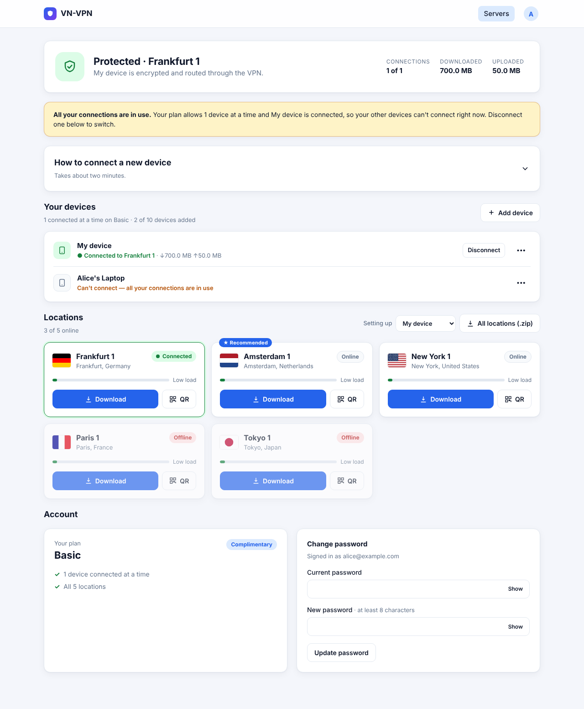
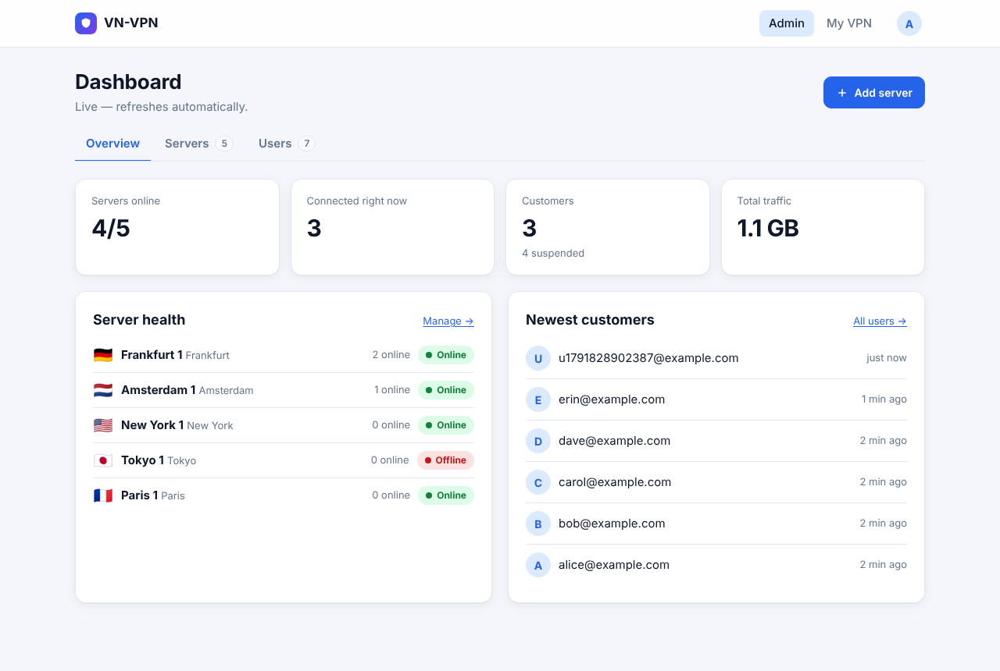
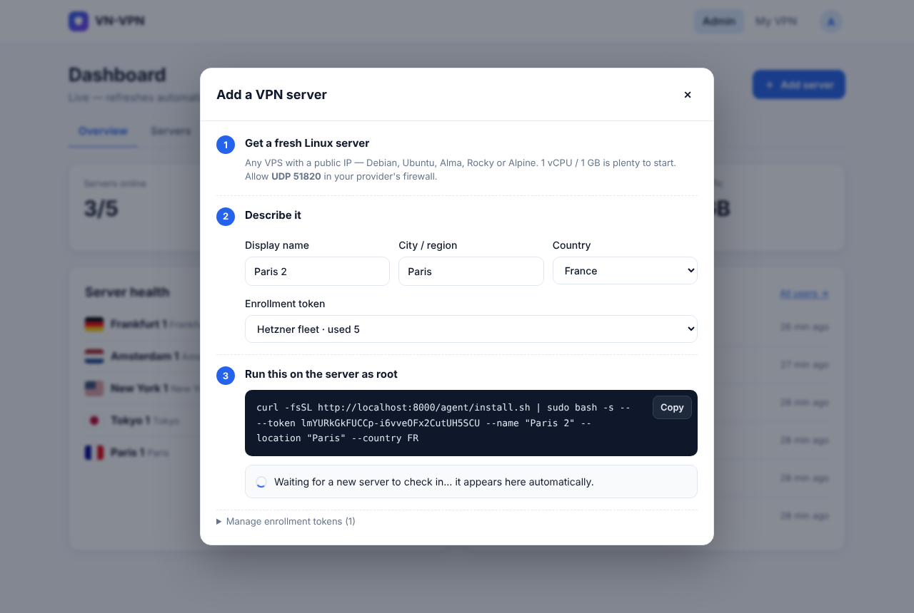

# VN-VPN

A self-hosted, resellable WireGuard VPN suite:

- **Management panel** (FastAPI + SQLite, one container) — deploy on Coolify.
- **Node agent** — turn any Linux VPS into a VPN server with one command. It installs WireGuard, registers with the panel and keeps its peer list in sync every 15s.
- **Client portal** — customers sign up, get a guided 3-step setup tailored to their device, and pick locations by flag with live load and a "Recommended" pick. The page turns green live when their tunnel connects; switching country is one tap in the WireGuard app.
- **Subscriptions (Stripe)** — the portal is paywalled. **Basic** = 1 device connected at a time, **Pro** = 5 at a time. Stripe Checkout, plan upgrades and the Stripe Customer Portal (cards, invoices, cancel) are built in.
- **Server monitoring** — per-server CPU, memory, disk, bandwidth and connected devices with live charts (1h / 24h / 7d), plus optional Discord/Slack alerts.
- **Traffic log** — where each customer connects from (their real IP, server, duration, data) and where their traffic goes (destination IP, port, bytes), searchable and exportable as CSV.
- **Public homepage** at `/` with live locations and pricing; sign-up flows straight into checkout.
- **Provisioning API** — let other systems create, suspend, delete users and grant plans.

| Client portal | Admin dashboard | Add-server wizard |
|---|---|---|
|  |  |  |

## How it works

```
 customer ── signs up ──▶ panel (Coolify) ◀── POST /api/agent/sync every 15s ── agent on VPS #1, #2, ...
    │                       │  users, servers, keys                              wg syncconf (no downtime)
    └── WireGuard app ──────┼──────────────── tunnel ─────────────────────────▶ any VPS
```

- Every **device** (one per phone or computer) gets its own WireGuard keypair and can use **every** location. Each server has its own address range (`10.64.0.0/16`, `10.65.0.0/16`, … from `VPN_POOL`), so a device's tunnels to different locations never overlap. Switching server = activating another tunnel in the WireGuard app.
- Agents pull the list of devices allowed right now: paying (or admin-granted) users only, capped at the plan's simultaneous-connection limit across all servers. When the limit is reached, the devices already connected keep their slots; another device can connect once one goes idle (~3 min) or the customer hits **Disconnect** in the portal (~15 s). Suspended, cancelled or deleted users drop off every server within ~15 seconds.
- Servers and tunnels are **IPv4-only**. Client configs also route IPv6 into the tunnel, where it's dropped, so it can't leak around the VPN. Configs use MTU 1380 and servers clamp TCP MSS, which avoids "connected but nothing loads" on mobile/PPPoE networks.
- Each server's private key is generated on the server and never leaves it. Agents authenticate with a per-node secret issued at enrollment.
- Servers keep running with their last config if the panel goes down, and restore it on reboot.

## Deploy the panel on Coolify

1. In Coolify: **+ New Resource → Public/Private Repository**, pick this repo, build pack **Docker Compose** (`docker-compose.yml`).
2. Set environment variables:
   | Variable | Required | Notes |
   |---|---|---|
   | `ADMIN_EMAIL`, `ADMIN_PASSWORD` | yes | Bootstrap admin account (created/promoted on start). |
   | `PROVISION_API_KEY` | no | Enables `/api/v1/users` for billing integrations. |
   | `OPEN_SIGNUP` | no | `true` (default) shows the public sign-up page. |
   | `BRAND_NAME` | no | Shown in the UI and config file names. |
   | `VPN_SUBNET`, `CLIENT_DNS` | no | Defaults `10.66.0.0/16`, `1.1.1.1, 1.0.0.1`. |
   | `NODE_CAPACITY` | no | Connected users at which a server shows as "Busy" (default 250). |
   `SECRET_KEY` and `PUBLIC_URL` are filled automatically by Coolify's `SERVICE_PASSWORD_64_SECRET` / `SERVICE_FQDN_PANEL` magic variables.
3. Set the domain for the `panel` service (e.g. `https://vpn.example.com`) and deploy. Data lives in the `vnvpn-data` volume.

Without Coolify: `docker build -t vnvpn . && docker run -p 8000:8000 -v vnvpn:/data -e ADMIN_EMAIL=... -e ADMIN_PASSWORD=... -e PUBLIC_URL=https://vpn.example.com vnvpn`

## Set up Stripe billing

1. In Stripe → **Product catalog**, create two products with a recurring price each, e.g. *Basic* ($4.99/month) and *Pro* ($9.99/month). Copy each **price ID** (`price_…`).
2. Stripe → **Developers → Webhooks → Add endpoint**: URL `https://vpn.example.com/billing/webhook`, events
   `checkout.session.completed`, `customer.subscription.created`, `customer.subscription.updated`, `customer.subscription.deleted`, `customer.subscription.paused`, `customer.subscription.resumed`. Copy the **signing secret** (`whsec_…`).
3. Stripe → **Settings → Billing → Customer portal**: turn it on (lets customers update cards, see invoices and cancel).
4. In Coolify set `STRIPE_SECRET_KEY` (`sk_live_…` or `sk_test_…`), `STRIPE_WEBHOOK_SECRET`, `STRIPE_PRICE_BASIC`, `STRIPE_PRICE_PRO`, and redeploy. Prices shown on the pricing page are read from Stripe.

Use test mode keys and card `4242 4242 4242 4242` to try it end to end. Optional: `PLAN_BASIC_DEVICES` / `PLAN_PRO_DEVICES` (default 1 / 5), `PLAN_BASIC_NAME` / `PLAN_PRO_NAME`, `MAX_DEVICES` (cap on devices a customer may add; default unlimited — only simultaneous connections are limited).

Customers with a failing card (`past_due`) keep access while Stripe retries; `unpaid`/`canceled` lose it. Admins can give anyone a plan for free from **Admin → Users → ••• → Give Basic/Pro free** (or `PUT /api/v1/users/{email}/plan`).

## Monitoring, alerts & traffic logging

Agents (v0.3.0+) report system stats on every check-in. Click a server in **Admin → Servers** for its charts; the servers table shows live CPU, memory and bandwidth.

**Alerts:** set `ALERT_WEBHOOK_URL` to a Discord or Slack incoming-webhook URL to get a message when a server goes offline / comes back, averages over `ALERT_CPU_PERCENT` (90) CPU for 5 minutes, or passes `ALERT_DISK_PERCENT` (90) disk.

**Traffic log** (**Admin → Traffic log**):
- *Connections* — customer, device, the public IP they connected from, server, start, duration, data. Off with `LOG_SESSIONS=false`; kept `SESSION_LOG_DAYS` (30).
- *Destinations* — every destination IP/port/protocol each device connected to, with connection count and bytes, from the server's connection-tracking table (`conntrack`). Off with `LOG_DESTINATIONS=false` (agents stop collecting within ~15 s); kept `FLOW_LOG_DAYS` (7). Group by destination to see the top destinations.
- *Insights* (the Insights tab of the admin dashboard) — a UniFi-style dashboard over the same data: bandwidth, data by category (Streaming, Social, Gaming…), top apps, clients, destinations, countries, DNS lookups, ports, and a live flow feed. Click anything to filter the whole page. Ranges: 1 hour to 7 days from the detailed log, 30 days and all time from hourly totals kept `INSIGHTS_DAYS` (365); bandwidth history is kept `METRICS_DAYS` (30). Website names come from the DNS answers devices receive through the tunnel and from the server name in TLS handshakes, which still works when a device uses encrypted DNS (agent 0.5.1+, an in-kernel filter on `wg0` so only those packets reach the agent). Destination country and network owner come from the free [iptoasn.com](https://iptoasn.com) database, or the ip-location-db mirror on jsDelivr if that fails, downloaded weekly into `geo.db` next to the panel database (`GEO_LOOKUP=false` to turn off). If neither download works, the Insights tab says why and has a *Download now* button; once the database loads, the earlier Unknowns are re-labelled.

> ⚖️ Logging customer traffic is a significant privacy decision for a VPN. Say exactly what you record and for how long in your privacy policy/terms, and check the rules where you and your customers are (e.g. GDPR in the EU). Use the retention settings to keep no more than you need.

Metrics are kept `METRICS_DAYS` (30). Old rows are deleted hourly.

## Add a VPN server

1. Admin → **Add server**. The wizard builds the command for you: pick a name, city and country (shown as a flag to customers). Create an enrollment token under *Manage enrollment tokens* if you don't have one (unlimited or N uses — one token can enroll a whole fleet).
2. On a fresh VPS (Debian/Ubuntu/RHEL/Alma/Rocky/Alpine), as root:
   ```bash
   curl -fsSL https://vpn.example.com/agent/install.sh | sudo bash -s -- --token <TOKEN> --name "Frankfurt 1" --location "Frankfurt" --country DE
   ```
   Optional: `--endpoint 203.0.113.10` (public IPv4 or a hostname resolving to it; otherwise the agent detects the server's own public IPv4), `--port 51820`.
   The panel can sit behind Cloudflare; VPN servers can't (WireGuard is UDP). Don't proxy a hostname you pass as `--endpoint`.
3. The wizard notices the new server check in and takes you to it; it's immediately available in every customer's portal. Open **UDP 51820** in your cloud provider's firewall/security group.

Agents update themselves when the panel is redeployed with a newer agent.

**Re-enroll a server** (reinstalled OS, rebuilt VPS, new IP, or the panel rejects it with "Unknown node"): **Admin → Servers → ••• → Re-enroll…** (or the button on the server's page) gives a one-time command, valid for an hour. Run it on the box; it reconnects to the same entry — name, location, flag, stats and logs are kept, and the key, IP and credentials are refreshed. No need to delete and re-add.

**Troubleshooting** — if a client shows "connected" but no traffic passes, run this on the server:
```bash
sudo python3 /opt/vnvpn/agent.py doctor
```
It checks forwarding, NAT, firewall rules, the registered endpoint and whether any client has completed a handshake, with a fix for each failure. If no device has ever handshaken, it's almost always **UDP 51820 blocked in the cloud provider's firewall** or a wrong endpoint (Admin → Servers → Edit).

Logs: `journalctl -u vnvpn-agent -f` · Uninstall: `curl -fsSL https://vpn.example.com/agent/install.sh | sudo bash -s -- --uninstall`

## Provisioning API

Interactive docs at `/api/docs`. All calls need `X-API-Key: $PROVISION_API_KEY`.

```bash
# create (password optional — generated and returned if omitted)
curl -X POST https://vpn.example.com/api/v1/users -H "X-API-Key: $KEY" -H "Content-Type: application/json" \
     -d '{"email":"customer@example.com"}'
curl -X POST https://vpn.example.com/api/v1/users/customer@example.com/suspend   -H "X-API-Key: $KEY"
curl -X POST https://vpn.example.com/api/v1/users/customer@example.com/unsuspend -H "X-API-Key: $KEY"
curl -X PUT https://vpn.example.com/api/v1/users/customer@example.com/plan -H "X-API-Key: $KEY" \
     -H "Content-Type: application/json" -d '{"plan":"pro"}'    # free plan ("" removes it)
curl -X DELETE https://vpn.example.com/api/v1/users/customer@example.com         -H "X-API-Key: $KEY"
curl https://vpn.example.com/api/v1/servers   # public server list + online status
```

## Tests

```bash
pip install -r requirements.txt -r requirements-dev.txt
python -m pytest
```

## Try it locally

```bash
pip install -r requirements.txt
DATABASE_PATH=./data/vnvpn.db ADMIN_EMAIL=admin@example.com ADMIN_PASSWORD=adminpass123 \
  PROVISION_API_KEY=testkey uvicorn app.main:app --reload
```

Open http://localhost:8000, log in as admin, create a token. You can simulate a node without WireGuard installed:

```bash
mkdir -p /tmp/node1
VNVPN_DIR=/tmp/node1 VNVPN_DRY_RUN=1 python3 agent/agent.py enroll --panel http://localhost:8000 --token <TOKEN> --name Test --location Lab
VNVPN_DIR=/tmp/node1 VNVPN_DRY_RUN=1 python3 agent/agent.py run      # prints the wg0.conf it would apply
```

Then sign up as a customer at `/signup` and download configs.

## Preliminary — known gaps before selling

- User WireGuard private keys are stored in the panel DB (needed to serve configs); encrypt at rest or move to client-side key generation.
- No bandwidth caps or free trials yet.
- No email verification / password reset; no CSRF tokens (SameSite=Lax cookies only).
- IPv4 only (IPv6 is routed into the tunnel and dropped, which prevents leaks).
- Traffic counters reset when a server's interface restarts.
- SQLite + single process — fine for hundreds of users/dozens of nodes; move to Postgres for more.
